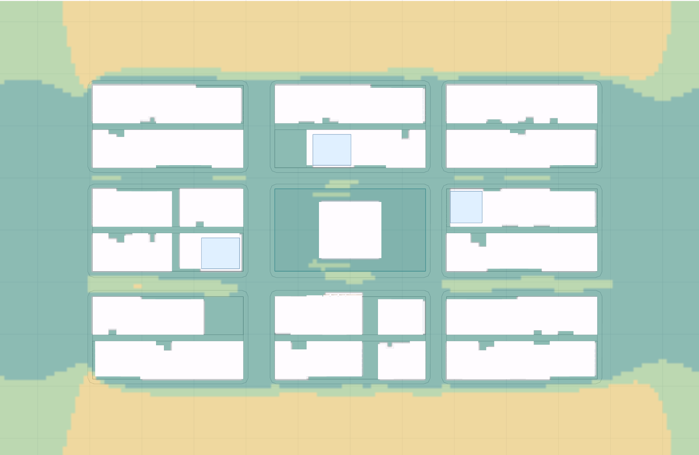

# Sun & Wind Studio



Early-design sun, wind, daylight, natural-ventilation and energy studies on a supertall tower in downtown Vancouver, in the browser. Upload a Rhino massing or generate one, then read how the form and its façade perform, at two levels of detail:

| Phase | What it answers | Model shown |
| --- | --- | --- |
| **Massing** | Site impact: new shadow on neighbours and plazas, sunlight taken from neighbouring façades, direct sun and sun hours per face, pedestrian wind comfort with and without the tower, downwash, wind with height, and a form-only massing efficiency rating. | Fused solid blocks |
| **Design development** | Façade zones (window size, glass, shading devices, PV, operable openings), daylight against LEED v4.1 EQ Daylight, natural ventilation against ASHRAE 62.1, CIBSE AM10 and ASHRAE 55, floor-plan views of sun, daylight factor, annual sun exposure and air paths, and a monthly energy model read against Vancouver's TEUI, TEDI and GHGI targets. | Floor plates with glazing bands, devices, PV, podium and canopy |

**Live:** https://xubynii.github.io/sun-wind-studio/ (GitHub Pages, served from `main`).

Weather is the CWEC2020 typical year for Vancouver International Airport (climate.onebuilding.org), loaded from `weather.json`; solar geometry is computed for the site. Everything is indicative: shadows are rendered hour by hour on the site model, the wind is a two-dimensional pedestrian-level flow, and the daylight, ventilation and energy readings use simplified rules in the manner of the standards they cite. None of it replaces a Radiance, CFD or EnergyPlus model for a permit or a LEED submission.

## How to use it

1. **Model.** Upload a `.3dm`, `.obj` or `.json` (metres, z up, closed volumes). Each layer becomes tower massing, a shading device, a PV surface, site context or terrain (a layer named topo, terrain, contour, grade or landform becomes the ground surface; the ground at the tower is set to 0 m). After an import a **Check the model** card scans the massing layer piece by piece (by layer name, then geometry) and asks you to confirm floor plates, ground floor, façade, windows, roof, ceiling, structure, core and stairs; Show highlights each in the model and layers can be reassigned. Confirmed plates set the storeys and plate outlines, and the windows and ceilings set each floor's sill and head per face, so the façade zones and their overhangs, louvres, fins and light shelves hang from the modeled heads in the drawing and in the sun, daylight and rain studies. The ground floor is set on the site ground and, unless the file is drawn in the site's own coordinates, turned parallel to the parcel and moved onto it; the core the core share, windows against façade the window-to-wall ratio of each face, and structure, stairs and panels are kept out of the solid. Model z = 0 is ground: geometry below it becomes basement floors, drawn below the site and left out of the studies, and the ground level can be moved under Uploaded model. On entering Design development the model is scanned for floor plates (horizontal faces covering a fifth or more of the footprint, at least three of them, at storey spacing); when it finds them you are offered the plates for storey heights and plate outlines, and when it does not (a plain mass, or a slab model whose spacing is not a storey) the mass is sliced at the floor-to-floor height you set, with the floor count shown as you change it. Or pick a typology (prism, taper, twist, tiers, shifted stack) and shape it with sliders.
2. **Site.** Position and rotate the tower on the competition parcel with the sliders, or drag the mass across the site in the viewport (snaps to 1 m, Alt for free movement; arrow keys nudge 1 m, Shift for 5 m; `[` and `]` rotate; Esc deselects); toggle the three future towers and street labels, or upload your own site model (`.3dm`, `.obj` or `.json`) here: each layer becomes context or terrain, replacing the Vancouver site or adding to it.
3. **Massing phase.** Run **Sun** (one date, or a period weighted by Vancouver's sunshine hours), **Wind** (one case, or eight sectors of the seasonal rose) and read **Efficiency** live. The analysis bar under the canvas switches the overlay and shows its legend.
4. **Design development.** Design the **Façade** by zone: a face over a level range with a strategy from the catalogue (curtain wall, punched windows, overhang, louvres, fins, egg-crate, light shelf, balconies, double skin, PV spandrel, green wall, terrace screens). Run **Daylight** and **Ventilation**; edit **Energy** construction and systems live. The review panel is drawn, not written: each study is a headline, three key figures and conventional analysis drawings (shadow range diagram, sun path, unrolled façade sun map, Lawson comfort bands, downwash section, wind rose by sector, wind profile with height, driving-rain rose and exposure diagram, wetted-wall chart, ponding bars, form radar, energy against targets, end-use donut), with the readings, tables and method notes kept for the report and the hover notes.
5. **Report.** Tick the sections, name the levels for plan sheets, and generate a PDF.

## What the studies compute

- **Sun and shadow.** NOAA solar position for 49.28° N, hourly renders of the site with and without the tower; new shadow on the ground, plazas, the transit plaza and the parcel; sunlight lost by neighbouring façades; direct beam per face with height encoded per pixel so each façade zone sees the sun that reaches its own levels.
- **Façade.** Device transmission per hour from profile and horizontal shadow angles; heat through glazing with and without devices; low-sun glare hours; PV yield with an all-sky diffuse allowance; daylight aperture.
- **Daylight.** Split-flux daylight factor from eight sight lines per floor cell with the neighbours' obstruction angle and the zone's device; an sDA300/50% proxy against the LEED bands of 40, 55 and 75%; annual sunlight exposure (1,000 lux for 250 h) from a sun sweep, against the 10% limit.
- **Rain.** Driving rain per face in the manner of ISO 15927-3 and BS 8104 (annual index from a rain rose of Vancouver's south-easterly fronts, wall factors rising toward the top of a tall wall, exposure bands), the wetted share of each face by height in a design storm, the rain shadow the building, podium and canopy cast on the ground (rendered from the storm angle, wind speed over drop fall speed), entrance shelter, the glass each zone's overhangs and balconies keep dry, roof catchment, run-off, gutter outlets, edge cascades, harvesting yield and cistern sizing from a flow-routing model of the terraces, and, when the site has topography, where water pools: priority-flood depression filling on a 2 m ground grid from the imported terrain, run-off routed down the steepest slope with buildings impassable, each hollow filling from its catchment (rain depth × run-off coefficient for paved, mixed or planted ground, plus the terraces' edge cascades at the base) and spilling to the next, with ponds drawn by depth, run-off paths, and a warning when a pond touches the tower's base.
- **Wind.** D2Q9 lattice-Boltzmann pedestrian flow on 4 m cells, Lawson comfort bands, downwash amplification from the height ratio to neighbours, and the effect of a podium, canopy, corner treatment and plaza shelter; power-law wind with height and gust pressure.
- **Natural ventilation.** Operable zones give free opening area; CIBSE AM10 depth rules (2.5 H single-sided, 5 H cross, 12 m stack); ASHRAE 62.1 checks (4% openable area, 8 m reach); BS 5925 wind and stack flow for air changes; usable hours from monthly normals against a fixed or ASHRAE 55 adaptive band; wind on terraces with and without screens.
- **Energy.** ISO 13790-style monthly balance per program zone: transmission and ventilation losses, internal and solar gains with a utilisation factor; TEUI, TEDI and GHGI against City of Vancouver rezoning targets weighted by program. Programs are derived from the massing. In the massing phase, a form-only study rates form factor, surface-to-volume, heat-loss index, compactness, orientation balance, daylit area and exposed roofs.

## Run locally

The page loads three.js and jsPDF from cdnjs and the Rhino importer fetches a WebAssembly file, so serve the folder rather than opening `index.html` from disk:

```
git clone https://github.com/xubynii/sun-wind-studio.git
cd sun-wind-studio
python -m http.server 8000
```

then open http://localhost:8000/. Any static host works the same way. PDFs download through the browser; inside the claude.ai artifact they use its download prompt.

## Files

| File | Role |
| --- | --- |
| `index.html` | page, styles and layout |
| `core.js` | massing engine, 3D viewport, site model, floor slicing and program derivation (shared with the Supertall Massing Lab) |
| `study.js` | sun, shadow, façade zones, daylight, wind, ventilation, floor plans, review panel, scorecard and report builder |
| `energy.js` | massing efficiency and the monthly energy model |
| `rain.js` | driving rain, rain shadow, entrance shelter, roof catchment and site ponding on the terrain |
| `io.js` | Rhino / OBJ / JSON import with layer roles |
| `climate.js` | Vancouver climate: loads `weather.json` at boot, typed normals as fallback |
| `weather.json` | CWEC2020 typical year for Vancouver Intl AP (WMO 718920) distilled from the EPW: hourly temperature, wind, irradiation; monthly normals; monthly and annual wind roses; rain rose and ISO 15927-3 driving-rain sums (monthly rainfall normals from the station's .stat file, spread over overcast humid hours, since the EPW carries no hourly rain) |
| `viz.js` | drawing kit: bars, paired bars, stacked bands, roses, compass bars, line charts, façade maps, monthly bars, gauges, radar and donut figures shared by the panel and the PDF |
| `figdocs.js` | figure explainers: click any diagram in the review panel for what it shows, how to read it, how it is computed, what good looks like, design moves and sources |
| `parts.js` | model parts review after import: classifies and highlights floor plates, ground floor, façade, windows, roof, ceiling, structure, core and stairs, and applies what you confirm |
| `report.js` | PDF reports (jsPDF) |
| `site.json`, `rhino3dm.min.js`, `rhino3dm.wasm` | downtown Vancouver site model and the Rhino loader |

Settings persist in the browser's local storage per device.

## Views and the clipping plane

- **3D, Elevation, Section, Plan.** Elevation, Section and Plan are true orthographic views, square to the model: the plan looks straight down with north up, and elevations and sections are level. They stay 2D: dragging pans, the wheel zooms about the cursor, and only 3D orbits.
- **Elevation.** Press Elevation again to go round the four faces: south, east, north and west. Anything between the viewer and the tower's nearest face is cut away. The ground is drawn as hatched earth with the floors below ground dashed in it, and the levels are marked.
- **Section A-A.** There is one section view. A key plan in the corner shows the parcel and the footprint with the cut line. Drag the line to move the cut and drag an end dot to turn it (5 degree snap, Alt for free). Click an arrow or Look the other way to flip it. E-W and N-S set the two main cuts. The cut is drawn as a section drawing over the washed-back building beyond:
  - slabs, exterior walls, basement walls and core walls in solid poche;
  - glazing as thin lines between each storey's sill and head, from its facade zone;
  - basements cut into hatched earth;
  - level datums and a scale bar.
- **Floor plans.** Plan opens the ground floor as a plan drawing cut 1.2 m above the finished floor. The level list, or the up and down arrows, steps through every floor and basement, and Site gives the roof plan. The drawing follows North American and ISO 128 conventions:
  - **Cut elements.** Exterior and basement walls, columns, core walls and fins are solid poche with the heaviest line. Curtain wall shows as frame lines with the glass between them and mullions every 1.5 m. Punched windows are openings in a solid wall.
  - **Below and above the cut.** Items below the cut, such as the floor below, balcony slabs and louvres, are thin solid lines. Items above it, such as the floor above, overhangs and light shelves, are dashed.
  - **Core.** The core has a lift bank with lobby openings and two stairs with treads, break line, UP arrow and door swings.
  - **Annotation.** Each plan has a structural grid with numbered and lettered bubbles, chained and overall dimensions, and a room tag with the gross area. It also shows the A-A section line with its arrows, the property line on the levels above ground, a north arrow and a scale bar. Basements sit in hatched earth.
  - **Uploaded models.** The checked structure, core, stairs, façade and windows are cut from the model itself at the plan height. Parts that are not modeled are drawn from the floor plate, the façade zones and the core size. The columns follow an indicative grid of about 9 m.
- **Clip.** A clipping plane like Rhino's. It can be vertical, for sections, or horizontal, for plan cuts at any height including below grade. Set its turn and position in the panel, or drag the orange handle in 3D. Flip side keeps the other half, and Look at the section opens the orthographic view of the cut.
- **Cut display.** While the plane is on, the ground becomes a block of earth and cut solids show a flat fill: dark for the building, tan for the earth, brown for basements. Section always frames the basements.
- **Import.** Choosing a model file goes straight to the model check: layers take their guessed roles. Change layer roles reopens the role table and Re-import applies it. Only a file with no massing layer stops at the table.
