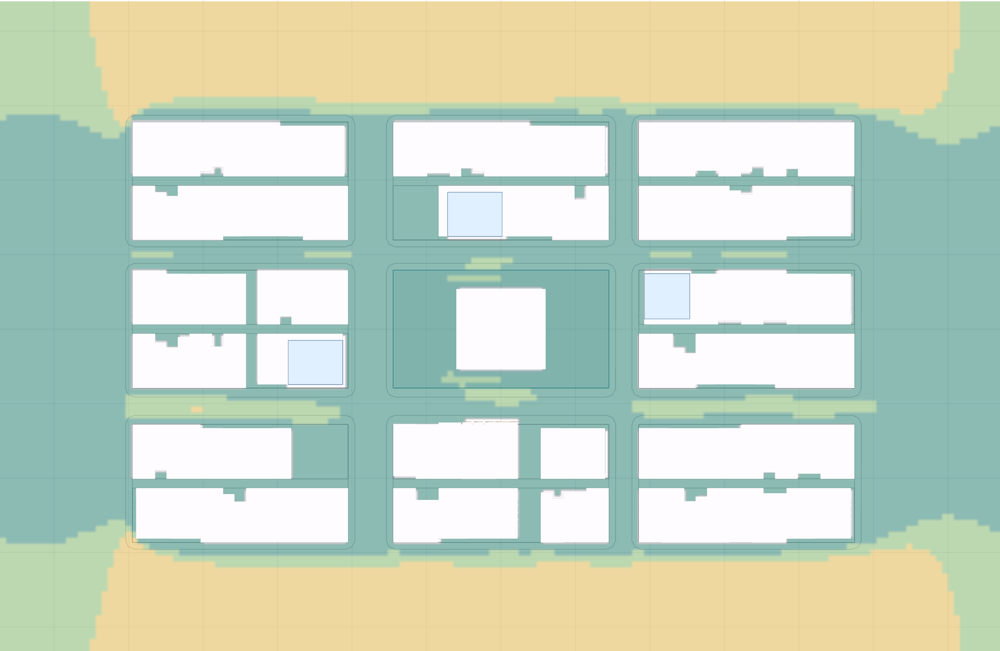

# Sun & Wind Studio



Early-design sun, wind, daylight, natural-ventilation and energy studies on a supertall tower in downtown Vancouver, in the browser. Upload a Rhino massing or generate one, then read how the form and its façade perform, at two levels of detail:

| Phase | What it answers | Model shown |
| --- | --- | --- |
| **Massing** | Site impact: new shadow on neighbours and plazas, sunlight taken from neighbouring façades, direct sun and sun hours per face, pedestrian wind comfort with and without the tower, downwash, wind with height, and a form-only massing efficiency rating. | Fused solid blocks |
| **Design development** | Façade zones (window size, glass, shading devices, PV, operable openings), daylight against LEED v4.1 EQ Daylight, natural ventilation against ASHRAE 62.1, CIBSE AM10 and ASHRAE 55, floor-plan views of sun, daylight factor, annual sun exposure and air paths, and a monthly energy model read against Vancouver's TEUI, TEDI and GHGI targets. | Floor plates with glazing bands, devices, PV, podium and canopy |

**Live:** https://xubynii.github.io/sun-wind-studio/ (GitHub Pages, served from `main`).

Everything is indicative: shadows are rendered hour by hour on the site model, the wind is a two-dimensional pedestrian-level flow, and the daylight, ventilation and energy readings use simplified rules in the manner of the standards they cite. None of it replaces a Radiance, CFD or EnergyPlus model for a permit or a LEED submission.

## How to use it

1. **Model.** Upload a `.3dm`, `.obj` or `.json` (metres, z up, closed volumes). Each layer becomes tower massing, a shading device, a PV surface or site context. Or pick a typology (prism, taper, twist, tiers, shifted stack) and shape it with sliders.
2. **Site.** Position and rotate the tower on the competition parcel; toggle the three future towers and street labels, or import your own context.
3. **Massing phase.** Run **Sun** (one date, or a period weighted by Vancouver's sunshine hours), **Wind** (one case, or eight sectors of the seasonal rose) and read **Efficiency** live. The analysis bar under the canvas switches the overlay and shows its legend.
4. **Design development.** Design the **Façade** by zone: a face over a level range with a strategy from the catalogue (curtain wall, punched windows, overhang, louvres, fins, egg-crate, light shelf, balconies, double skin, PV spandrel, green wall, terrace screens). Run **Daylight** and **Ventilation**; edit **Energy** construction and systems live. The review panel shows a LEED and Vancouver-target scorecard, the interactive floor plan and every study.
5. **Report.** Tick the sections, name the levels for plan sheets, and generate a PDF.

## What the studies compute

- **Sun and shadow.** NOAA solar position for 49.28° N, hourly renders of the site with and without the tower; new shadow on the ground, plazas, the transit plaza and the parcel; sunlight lost by neighbouring façades; direct beam per face with height encoded per pixel so each façade zone sees the sun that reaches its own levels.
- **Façade.** Device transmission per hour from profile and horizontal shadow angles; heat through glazing with and without devices; low-sun glare hours; PV yield with an all-sky diffuse allowance; daylight aperture.
- **Daylight.** Split-flux daylight factor from eight sight lines per floor cell with the neighbours' obstruction angle and the zone's device; an sDA300/50% proxy against the LEED bands of 40, 55 and 75%; annual sunlight exposure (1,000 lux for 250 h) from a sun sweep, against the 10% limit.
- **Wind.** D2Q9 lattice-Boltzmann pedestrian flow on 4 m cells, Lawson comfort bands, downwash amplification from the height ratio to neighbours, and the effect of a podium, canopy, corner treatment and plaza shelter; power-law wind with height and gust pressure.
- **Natural ventilation.** Operable zones give free opening area; CIBSE AM10 depth rules (2.5 H single-sided, 5 H cross, 12 m stack); ASHRAE 62.1 checks (4% openable area, 8 m reach); BS 5925 wind and stack flow for air changes; usable hours from monthly normals against a fixed or ASHRAE 55 adaptive band; wind on terraces with and without screens.
- **Energy.** ISO 13790-style monthly balance per program zone: transmission and ventilation losses, internal and solar gains with a utilisation factor; TEUI, TEDI and GHGI against City of Vancouver rezoning targets weighted by program. Programs are derived from the massing. In the massing phase, a form-only study rates form factor, surface-to-volume, heat-loss index, compactness, orientation balance, daylit area and exposed roofs.

## Run locally

The page loads three.js and jsPDF from cdnjs and the Rhino importer fetches a WebAssembly file, so serve the folder rather than opening `index.html` from disk:

```
git clone https://github.com/xubynii/sun-wind-studio.git
cd sun-wind-studio
python -m http.server 8000
```

then open http://localhost:8000/. Any static host works the same way. PDFs download through the browser; inside the claude.ai artifact they use its download prompt.

## Files

| File | Role |
| --- | --- |
| `index.html` | page, styles and layout |
| `core.js` | massing engine, 3D viewport, site model, floor slicing and program derivation (shared with the Supertall Massing Lab) |
| `study.js` | sun, shadow, façade zones, daylight, wind, ventilation, floor plans, review panel, scorecard and report builder |
| `energy.js` | massing efficiency and the monthly energy model |
| `io.js` | Rhino / OBJ / JSON import with layer roles |
| `climate.js` | Vancouver climate normals |
| `report.js` | PDF reports (jsPDF) |
| `site.json`, `rhino3dm.min.js`, `rhino3dm.wasm` | downtown Vancouver site model and the Rhino loader |

Settings persist in the browser's local storage per device.
